# Fase 0 · Diseño propuesto

Sistema integral de control para panadería (ERP) — documento para aprobación.
Fecha: 21/11/2026 · Estado: ✅ **APROBADO por escrito el 21/11/2026** (secciones 1 a 5). POS adelantado (sección 5). Pendiente: las respuestas que bloquean la Fase 1A.

> **Revisión 3 (prompt versión 3):** el desarrollo se hace en un **repositorio temporal de GitHub** (`carsam68-MonheyB/SAS-EL-PAN-DE-CADA-DIA`) conectado a un **proyecto temporal en la cuenta actual de Netlify**, solo con datos ficticios. Antes de cargar datos reales se traslada a la estructura definitiva del negocio. No se instala nada en la computadora del dueño.

Contenido:
1. Validación de la plataforma Netlify contra el documento
2. Autenticación y doble factor
3. Arquitectura
4. Modelo de datos (Mermaid)
5. Plan de fases detallado
6. Qué necesito para empezar

---

## 1. Validación de la plataforma Netlify

> ✅ **Sección 1 aprobada completa (puntos 1 a 5) el 21/11/2026.**

Revisé la documentación vigente de Netlify (noviembre 2026). Resumen: **todo el documento cabe en la plataforma**, con cinco puntos que cambian el diseño o que debes revisar en tu plan.

### 1.1 Lo que sí cabe tal como lo pediste

| Requisito | Situación en Netlify |
|---|---|
| PostgreSQL administrado con `@netlify/database` | Disponible y en GA desde abril 2026. El paquete se instala, se despliega y Netlify crea la base. `@netlify/neon` quedó reemplazado. |
| Transacciones `BEGIN/COMMIT` con un cliente del pool | El paquete expone `db.pool` (un `pg.Pool`) justamente para esto. |
| Migraciones versionadas | Netlify tiene migraciones nativas en `netlify/database/migrations/` que se aplican en cada despliegue. Las usaremos. |
| Procesos largos | Background Functions: hasta **15 minutos** por ejecución, con 2 reintentos automáticos. Suficiente para descarga masiva del SAT por pasos, recálculos y cierres. |
| Procesos programados | Scheduled Functions (cron). Solo corren en el despliegue publicado. Su tiempo es corto, así que solo **disparan** Background Functions. |
| Archivos (XML, PDF, layouts originales) | Netlify Blobs. |
| Límites del plan Pro para la base | 100 GB de almacenamiento, 100 GB de escritura y 100 GB de transferencia al mes por base, hasta 16 unidades de cómputo. Muy por encima de lo que necesita una panadería. |

### 1.2 ⚠️ Punto 1 — Ambientes: temporal de desarrollo y estructura definitiva

> ✅ **Aprobado (21/11/2026).**

**Durante el desarrollo (temporal):**

| Pieza | Dónde |
|---|---|
| Código | Repositorio privado `carsam68-MonheyB/SAS-EL-PAN-DE-CADA-DIA`. Yo trabajo en la rama `desarrollo`; `main` solo cambia con tu aprobación |
| Despliegue | Proyecto nuevo en tu cuenta actual de Netlify, conectado al repositorio |
| Pruebas de cada cambio | **Deploy previews**: cada una con su propia rama de base, copiada de la base de `main` |
| Versión aprobada | Rama `main`, que se despliega sola |
| Datos | **Solo ficticios** (`PRUEBA-…`), tanto en `main` como en las previews |

Que las deploy previews copien la base de `main` no es problema aquí, porque `main` solo tiene datos ficticios.

Reglas mientras tanto:
- **Plan Personal por créditos** (decisión del 21/11/2026): 1,000 créditos al mes compartidos con tus otros proyectos; no se paga Pro durante el desarrollo. Netlify Database sí está disponible en Personal (5 bases, 100 ramas, respaldos de 7 días, la base duerme a los 5 minutos). Consumo esperado del ERP en desarrollo: unos 500 a 700 créditos al mes. Para cuidarlos:
  - Las deploy previews no cuestan créditos de despliegue; cada publicación en `main` cuesta 15. Por eso se pasa a `main` solo al cerrar cada fase.
  - La base solo despierta mientras alguien prueba.
  - Si se agotan, Netlify pausa **todos** tus proyectos. Revisa *Usage* cada semana; la recarga en Personal es de 500 créditos por USD 5.
- No se cargan ventas ni clientes reales, ni la e.firma o el CSD reales. La Fase 8 se prueba con el **ambiente de pruebas del PAC**. La descarga y conciliación de un mes real del SAT se hace ya en la estructura definitiva.
- Los créditos se comparten con tus otros proyectos. En desarrollo el consumo es bajo, porque la base solo despierta mientras se prueba. Activa la recarga automática.
- Las variables de entorno del ERP van **a nivel del proyecto**, nunca a nivel del team.

**Lo que confirma la documentación vigente de Netlify:**
- Las migraciones se aplican solas en cada despliegue. En producción, justo antes de publicar; si fallan, no se publica. En las previews, antes de que estén disponibles.
- Al publicar un despliegue de producción se toma un **respaldo automático** justo antes (en Pro se guardan los de los últimos 10 despliegues).
- La restauración se hace desde el panel. Solo la puede hacer el Team Owner.

**Regla de migraciones:** como la migración se aplica un momento antes de publicar el código nuevo, las migraciones serán **compatibles hacia atrás**: primero se agrega, y lo viejo se retira en una publicación posterior.

**Traslado a la estructura definitiva** (antes de cargar datos reales; P68):
1. Repositorio y proyecto de Netlify en las cuentas del negocio. GitHub permite **transferir** el repositorio con todo su historial.
2. Variables de entorno con **llaves nuevas**. La llave de cifrado de desarrollo nunca se usa en producción.
3. Primer despliegue: la base nueva se crea vacía y las migraciones construyen todas las tablas. No se trasladan datos ficticios.
4. En producción se **desactivan las deploy previews y los branch deploys**, para que ninguna rama toque la base real. Las pruebas siguen en un segundo proyecto, "pruebas", con su propia base.
5. Configurar en el panel el auto‑escalado, el tiempo para dormir y la recarga automática.
6. Carga de datos reales con los layouts.

### 1.3 ⚠️ Punto 2 — Costo de la base: se cobra mientras esté despierta

> ✅ **Aprobado (21/11/2026).**

- La base consume **10 créditos por unidad de cómputo por hora** activa, más 20 créditos por GB transferido.
- Se duerme tras **5 minutos sin consultas** (es el mínimo configurable). El mínimo de cómputo es 1 unidad.
- Con el POS vendiendo, la base no se va a dormir en horario de operación. Estimación: si la operación es de 14 h diarias, todos los días, son 14 × 30 = 420 horas, es decir unos **4,200 créditos al mes solo de cómputo de base** a 1 unidad (sin contar funciones ni transferencia).
- **Acción para ti (P03):** confirma cuántos créditos incluye tu plan Pro y el precio del crédito adicional. Con tu horario (P12) te doy la cifra exacta.
- Configuración que propongo: cómputo mínimo 1, máximo 2, dormir a los 5 minutos. Además, los procesos programados (respaldos, descarga SAT, recálculos) se agrupan en **una sola ventana diaria** dentro del horario en que la base ya está despierta, para no despertarla de madrugada.
- **Indicador de consumo en administración:** no encontré en la documentación un endpoint público que dé los créditos consumidos. Propongo: (a) registrar nosotros las horas activas estimadas (primera y última consulta de cada bloque) y mostrar la estimación; y (b) en Fase 1 verificar si la API de Netlify expone el consumo para mostrar el dato oficial. Te lo confirmo antes de construirlo.

### 1.4 ⚠️ Punto 3 — Respaldos de Netlify: 30 días en Pro

> ✅ **Aprobado (21/11/2026).**

En Pro, los respaldos programados se conservan **30 días**, más uno por cada uno de los últimos 10 despliegues publicados. No alcanza para el plazo legal de conservación de la contabilidad (el CFF, art. 30, habla en general de 5 años; confírmalo con tu contador). Por eso se necesita la copia externa que ya pediste. Diseño:

1. Una **Scheduled Function** (el día 1 de cada mes) y el **cierre contable** disparan una **Background Function**. Esta exporta la base tabla por tabla, cifra el archivo y lo sube al almacenamiento externo (P06). El avance se ve en pantalla.
2. El almacenamiento externo con **Object Lock (WORM)** y una credencial que **solo puede escribir, no borrar**. Así se cumple "ninguna función puede borrar respaldos".
3. Los XML de CFDI se copian a ese almacenamiento organizados como `cfdi/{RFC}/{emitidos|recibidos}/{AAAA}/{MM}/{UUID}.xml`.
4. Antes de producción: procedimiento de restauración documentado y una prueba real de restauración (en la base local, o en el proyecto "pruebas" si se crea).

Todo el respaldo automático corre dentro de Netlify. Ninguna credencial del sistema puede borrar en el almacenamiento externo.

### 1.4‑B Respaldo del código

El código vive en GitHub con todo su historial. Además, en cada versión aprobada te mando un paquete `.zip` (sin `node_modules`, `.env` ni secretos) para que guardes una copia fuera de GitHub, por ejemplo en tu OneDrive.

### 1.5 ⚠️ Punto 4 — Netlify Identity no tiene doble factor

> ✅ **Aceptado (21/11/2026):** se usa la autenticación propia con TOTP (sección 2).

Netlify revirtió en febrero 2026 la baja de Netlify Identity y sigue dándole soporte, pero **no ofrece doble factor (MFA) para los usuarios del sitio**. Por eso no cumple la sección 4.0. Las opciones están en la sección 2 de este documento.

### 1.6 ⚠️ Punto 5 — Pagos con tarjeta

> ✅ **Aceptado (21/11/2026):** el sistema **nunca guarda números de tarjeta**; solo la referencia o el número de autorización del voucher de la terminal bancaria.

Netlify Database **no está certificada PCI‑DSS**, así que está prohibido guardar en ella números de tarjeta. El POS registra el cobro con tarjeta hecho en la **terminal bancaria** y guarda solo la referencia o el número de autorización del voucher.

### 1.7 Otros puntos técnicos

- Funciones síncronas: el límite es de pocos segundos (el valor exacto lo confirmo en Fase 1). Toda operación de usuario se diseña para responder en menos de 5 s. Lo pesado va como **proceso en segundo plano** con registro de avance (`proceso_fondo`) visible en pantalla.
- El pool de conexiones se configura con un tiempo de inactividad menor a 60 s, para que no reparta conexiones que ya se cerraron.
- Descarga masiva del SAT: la versión vigente que encontré es la **1.5** (en producción desde el 30/05/2025). Fuentes de terceros reportan intermitencias. Lo vuelvo a verificar contra la documentación oficial del SAT al iniciar la Fase 8.

### 1.8 Requisitos

- **No se instala nada en tu computadora.** Programo en una sesión de Claude Code en la nube conectada al repositorio, y Netlify despliega desde GitHub.
- Necesitas: que la **aplicación de Claude para GitHub** tenga acceso al repositorio, y conectar el repositorio al proyecto de Netlify (te guío).
- El auto‑escalado y el tiempo para dormir la base solo se configuran en el panel de Netlify. Te dejo los pasos en el README.

---

## 2. Autenticación y doble factor

> ✅ **Aprobado (21/11/2026).**

Los roles y permisos viven siempre en nuestra base. La decisión es solo **quién valida contraseña y segundo factor**.

| | **A) Autenticación propia (recomendada)** | **B) Auth0 (extensión de Netlify)** |
|---|---|---|
| Doble factor | TOTP (Google Authenticator, Microsoft Authenticator…). Opcional: llave de acceso (passkey/WebAuthn). | TOTP, push, WebAuthn. Revisar qué factores incluye el plan gratuito y cuáles son de pago. |
| PIN de cajero y cambio de cajero sin cerrar caja | Nativo, el mismo sistema. | Hay que construirlo aparte de todos modos (Auth0 no maneja PIN de POS). |
| Política de contraseñas, bloqueo y cierre por inactividad configurables desde nuestra pantalla | Sí, todo en `configuracion`. | Parcial: parte se configura en el panel de Auth0, fuera del sistema. |
| Bitácora de accesos en nuestra base | Directa. | Hay que traerla de los logs de Auth0. |
| Registro abierto | No existe: solo el administrador invita. | Hay que desactivarlo en Auth0. |
| Costo | Sin costo extra. | Por usuario activo al mes según el plan de Auth0 (verificar). |
| Riesgo | El código de seguridad es nuestro. Lo mitigamos con librerías probadas (`argon2` para hashes, `otplib` para TOTP), cookies `HttpOnly`/`Secure`/`SameSite=Strict`, protección CSRF, límites de intentos y pruebas automáticas. | Dependencia de un tercero y dos lugares donde administrar usuarios. |

**Decisión (21/11/2026): opción A, autenticación propia con TOTP.** Recomendación original: A. El PIN de cajero, las políticas configurables y la bitácora de accesos ya obligan a tener casi todo el módulo en casa, y así no hay un segundo panel de usuarios. Si prefieres un proveedor externo por política de seguridad, B funciona: el diseño de roles y permisos no cambia (P20).

Detalles de A:
- La sesión vive en el servidor (tabla `sesion`) y viaja en una cookie con el identificador firmado. El cierre por inactividad se valida en el servidor.
- El acceso es con **usuario** (clave) y contraseña; el correo es opcional, para que cajeros y panaderos no necesiten buzón.
- Alta de usuario: el administrador lo da de alta y el sistema genera una invitación con un enlace de un solo uso. Se envía por correo si el usuario tiene uno; si no, el administrador la entrega impresa o en pantalla. El usuario fija su contraseña y, si su rol lo exige, registra el TOTP. Incluye códigos de recuperación.
- El PIN de cajero solo sirve **en una caja ya abierta por una sesión completa**. Identifica al cajero para cada venta; no da acceso al resto del sistema.

---

## 3. Arquitectura

> ✅ **Aprobado (21/11/2026).**

### 3.1 Vista general

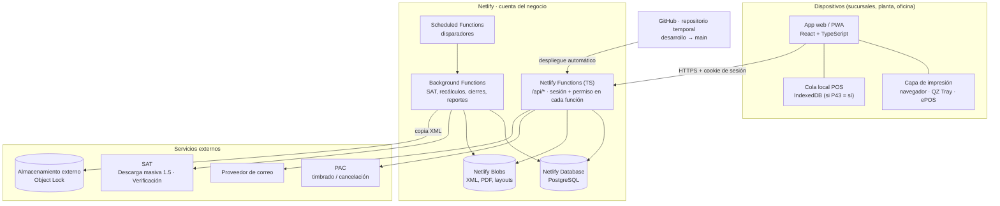

### 3.2 Tecnología propuesta

| Capa | Elección | Por qué |
|---|---|---|
| Frontend | **React + TypeScript + Vite**, UI con **Mantine** (tablas, formularios, fechas con idioma es‑MX), TanStack Query, React Router | Ecosistema maduro, buen soporte táctil para el POS, PWA sencilla con `vite-plugin-pwa`. |
| Validación | **Zod**, con esquemas compartidos entre frontend y backend | El mismo esquema valida el formulario, la API y cada renglón de un layout. |
| Backend | Netlify Functions en TypeScript (formato moderno `export default` + `config.path`) | Lo pide el documento. |
| Acceso a datos | `@netlify/database` → `db.pool` + **Kysely** (constructor de consultas tipado). Migraciones en SQL puro. | Las transacciones se controlan explícitamente y el SQL de cálculos complejos queda legible. |
| Aritmética | PostgreSQL `NUMERIC` + **decimal.js** en TypeScript. Los montos viajan como **texto**, nunca como `number`. | Regla 4: nada de punto flotante. Se agrega una regla de lint que prohíbe operar importes con `number`. |
| Precisión | Cantidades `NUMERIC(18,6)` (≥ 4 decimales), costos unitarios `NUMERIC(18,6)`, importes `NUMERIC(18,2)`. Modo de redondeo en `configuracion`. | |
| Layouts | `exceljs` (Excel con listas desplegables), `papaparse` (CSV/TXT), `iconv-lite` + detección de UTF‑8/Windows‑1252 | Sección 4.11. |
| PDF / XML | `pdfmake` (OC, representación impresa del CFDI), `fast-xml-parser`, `xml-crypto` / `node-forge` (firma de solicitudes al SAT con la e.firma) | |
| Pruebas | **Vitest** para el dominio (cálculo puro) y `@netlify/database-dev` (Postgres real) para pruebas de API, permisos y transacciones | Regla 7. |
| Zona horaria y formato | `timestamptz` en la base y presentación en `America/Mexico_City`. Fechas **DD/MM/AAAA**, números `1,250.75`. | |

### 3.3 Estructura del repositorio

```
erp-panaderia/
├── apps/web/                    # React (POS, producción, oficina)
│   └── src/impresion/           # capa de impresión intercambiable
├── netlify/
│   ├── functions/               # una función por recurso: /api/usuarios, /api/ventas…
│   └── database/migrations/     # migraciones SQL versionadas
├── packages/
│   ├── dominio/                 # LÓGICA PURA Y PROBADA: explosión, costeo, valuación,
│   │                            # impuestos, pólizas, conversiones, % panadero
│   ├── servidor/                # sesión, permisos, transacción, bitácora, errores
│   └── esquemas/                # Zod compartido + definición de layouts
├── datos-prueba/                # SOLO FICTICIOS, con prefijo "PRUEBA-" (regla 8)
├── docs/                        # este diseño, manuales, restauración de respaldos
├── scripts/                     # paquete de código, utilidades
└── .github/workflows/           # pruebas automáticas en cada push
```

### 3.4 Reglas transversales (cómo se cumplen)

1. **Permisos en cada función.** Cada endpoint se declara así: `ruta({ permiso: 'compras.requisicion:autorizar', alcance: 'sucursal' }, handler)`. El envoltorio valida la sesión, el permiso, el alcance por sucursal/almacén, el límite por monto y la segregación de funciones **antes** de ejecutar. Si un endpoint no declara permiso, la prueba automática falla. Hay pruebas que llaman a la API con cada puesto de prueba (criterio de la Fase 1).
2. **Una transacción por operación.** El helper `enTransaccion(usuario, async (tx) => …)` toma un cliente del pool, hace `BEGIN`, fija `SET LOCAL app.usuario_id`, ejecuta, registra la bitácora y hace `COMMIT`. Ante cualquier error hace `ROLLBACK`. El movimiento de inventario, su costo y su póliza se escriben **en la misma transacción**.
3. **Bitácora inalterable.** Triggers de PostgreSQL escriben en `bitacora_auditoria` el valor anterior y el nuevo (`jsonb`) de toda tabla de negocio. La tabla tiene un trigger que **rechaza UPDATE y DELETE** y cada renglón guarda el hash del anterior (cadena de hashes), así que cualquier alteración se detecta. Ni el administrador puede editarla desde el sistema.
4. **No se borra, se cancela.** Los documentos que afectan inventario, caja o contabilidad tienen estatus. Cancelar genera el movimiento contrario, ligado al original (`cancela_a_id`).
5. **Periodo cerrado = bloqueado.** Un trigger impide insertar movimientos o pólizas con fecha en un periodo cerrado.
6. **Nada en duro.** Tasas, montos, tolerancias, redondeo, cuentas, reglas de contabilización, incompatibilidades y políticas de contraseña viven en catálogos o en `configuracion`, con vigencia y bitácora. Un dato fiscal faltante deja el documento como **"pendiente de configuración"** y no supone ningún valor.
7. **Secretos.** La llave maestra, el PAC y el correo van en variables de entorno de Netlify, distintas por proyecto. La e.firma y el CSD se guardan en la base cifrados con AES‑256‑GCM usando esa llave. Solo el permiso `fiscal.efirma:usar` puede descifrarlos, y nunca se escriben en logs.

### 3.5 Capa de impresión (POS)

Hay una interfaz única, `Impresora { imprimir(ticket), abrirCajon(), estado() }`, y tres adaptadores: **Navegador**, **QZ Tray** y **Epson ePOS** (o el SDK del fabricante que toque). El ticket se arma como un documento neutro (renglones, totales, QR, folio) y cada adaptador lo convierte a HTML de 58/80 mm o a comandos ESC/POS. Así el POS completo se construye y prueba con el adaptador de navegador, y el definitivo se conecta cuando me des el modelo (P45). En ese momento te comparo las tres opciones con costos.

**Actualización (caja Windows + OFICHIDO por USB):** Epson ePOS queda descartado. Orden propuesto: (1) **Chrome en modo kiosco** (`--kiosk-printing`) con el controlador de Windows, sin costo. Si hace falta abrir el cajón o leer el estado de la impresora y el controlador no lo permite, (2) un **agente local propio y ligero**, sin licencia, que recibe ESC/POS desde el navegador por `localhost`, o (3) QZ Tray con Premium Support, de pago anual en USD. Ojo: QZ Tray requiere un certificado o licencia de pago para imprimir sin el aviso de confirmación (verifico su precio vigente).

### 3.6 POS sin conexión (solo si P43 = sí)

- Catálogo, precios y existencias de la sucursal se guardan en IndexedDB.
- Cada caja recibe un **bloque de folios reservado**, y cada venta se identifica con un UUID generado en la caja. La sincronización es idempotente: reenviar una venta no la duplica.
- Al volver el internet, la cola se envía en orden. Si un producto quedó con existencia negativa, se reporta para revisión; la venta no se rechaza.
- Sin conexión no se puede facturar, cancelar ni autorizar nada que requiera validación del servidor.

### 3.7 Flujo de publicación

1. Trabajo en la rama `desarrollo`. En cada push corren las **pruebas automáticas** (GitHub Actions) y Netlify genera una **deploy preview** con su propia base.
2. Te paso la liga de la preview, qué cambió y cómo probarlo.
3. Con tu aprobación paso los cambios a `main`. Netlify aplica las migraciones, toma el respaldo y publica.
4. Te mando el paquete `.zip` de esa versión.

---

## 4. Modelo de datos

> ✅ **Aprobado (21/11/2026).**

Convenciones:
- Todas las tablas de negocio tienen `id uuid`, `creado_en`, `creado_por`, `actualizado_en`, `actualizado_por`, y están cubiertas por la bitácora.
- Un solo maestro **`articulo`** cubre los niveles N0 (insumo/empaque), N1 (intermedio) y N2 (SKU), con el campo `tipo`. Así inventario, kárdex, lotes y costeo funcionan igual para los tres niveles.
- Los diagramas muestran solo los campos clave, para que se puedan leer.

### 4.1 Seguridad, usuarios y configuración

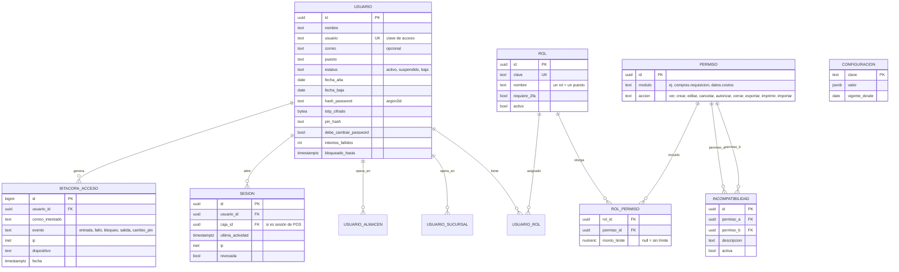

Los permisos sobre datos sensibles (ver costos, ver la receta completa, modificar precios, usar e.firma/timbrar/cancelar) son permisos del módulo `datos.*` o `fiscal.*`, separados de los permisos operativos.

### 4.2 Catálogos maestros

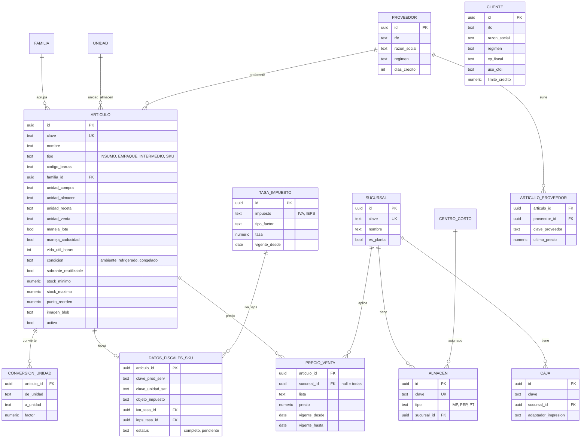

### 4.3 Recetas multinivel y costo estándar

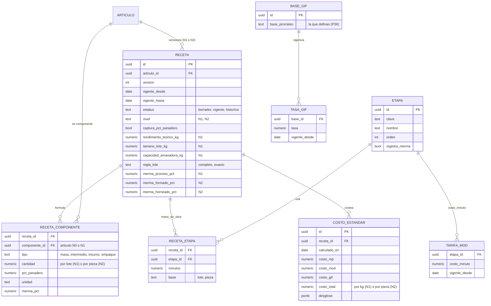

Al guardar una receta se valida que no haya ciclos (una receta no puede contenerse a sí misma, ni directa ni indirectamente). El costo estándar se recalcula en orden topológico N0 → N1 → N2.

### 4.4 Planeación y producción

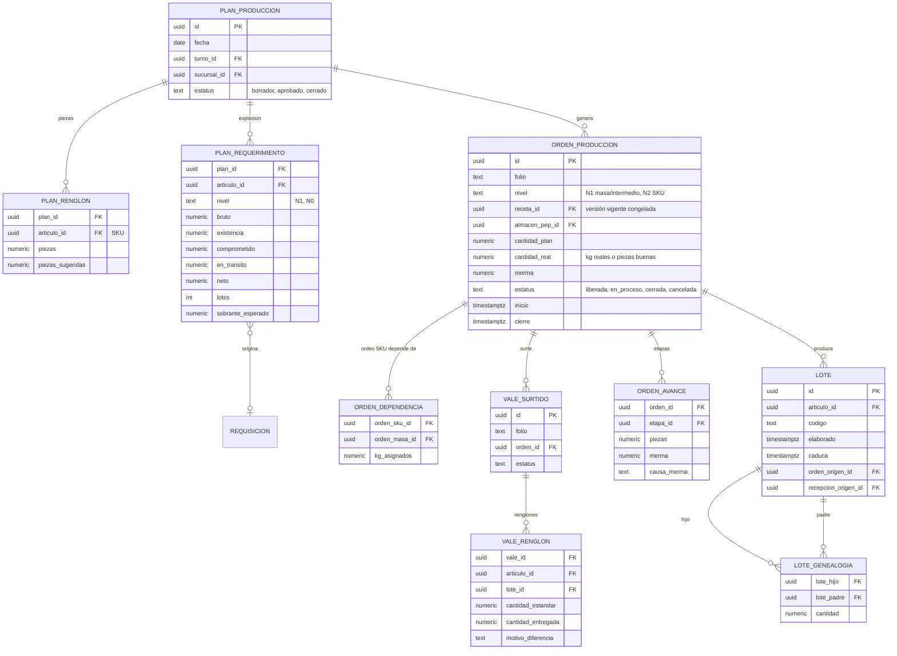

### 4.5 Inventarios y valuación

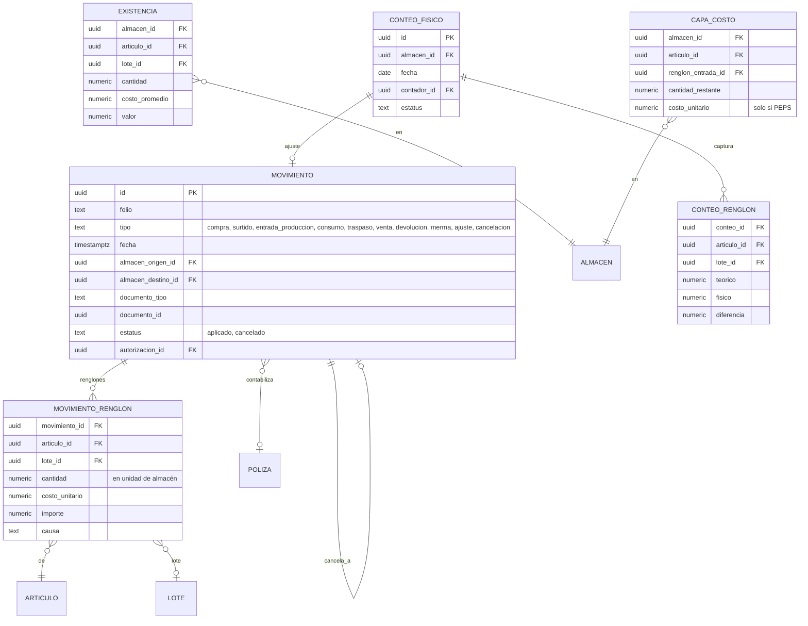

`MOVIMIENTO_RENGLON` es el kárdex: inmutable y la única fuente de verdad. `EXISTENCIA` y `CAPA_COSTO` son saldos que se actualizan en la misma transacción y se pueden reconstruir. El modelo soporta costo promedio y PEPS; el método activo sale de `configuracion` (P34).

### 4.6 Autorizaciones (genéricas) y compras

Un solo motor de autorizaciones sirve para compras, ajustes, mermas, devoluciones, descuentos, pólizas manuales y cargas de layout.

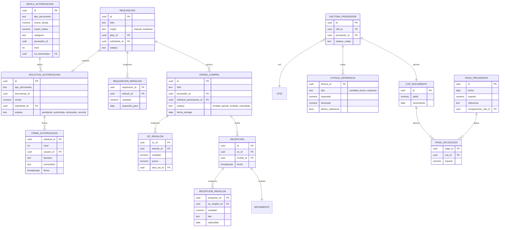

La segregación se valida al firmar: el solicitante no puede firmar su propia solicitud, y quien registró la recepción no puede autorizar el pago, además de las incompatibilidades configurables.

### 4.7 Punto de venta y caja

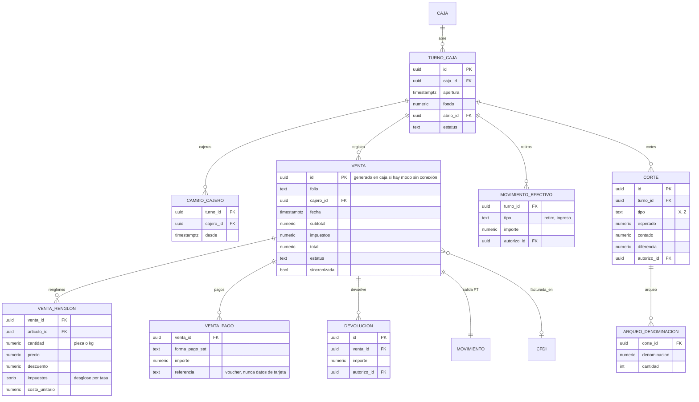

### 4.7‑B Pedidos, anticipos y cuentas por cobrar

El anticipo se registra como un **pasivo del cliente** (no es venta) y se aplica al entregar el pedido. Las cuentas por cobrar comparten la misma estructura de saldo de cliente. Por eso se diseñan desde ahora, aunque el crédito a clientes se active más adelante.

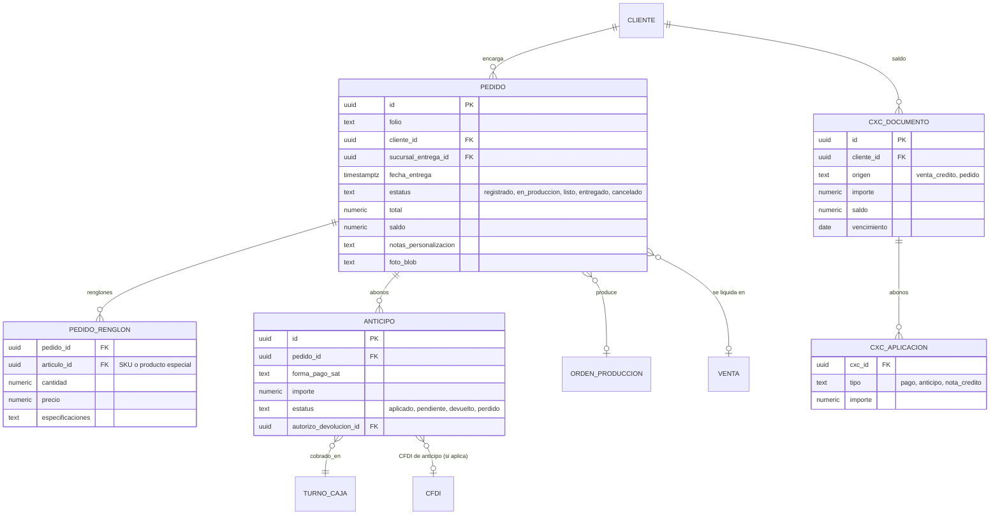

- Los pedidos con fecha de entrega entran automáticamente al **plan de producción** de su día.
- Cobrar un anticipo es un movimiento de caja del turno (cuadra en el corte) y genera su póliza contra la cuenta de anticipos que configures.
- El tratamiento fiscal del anticipo (CFDI de anticipo y relación 07, o factura al entregar) es configurable y lo decides con tu contador (P64).
- El crédito a clientes (límite, días, bloqueo por saldo vencido, antigüedad de saldos) usa `CXC_DOCUMENTO` y queda **apagado** en `configuracion` hasta que lo pidas.

### 4.8 Contabilidad y fiscal

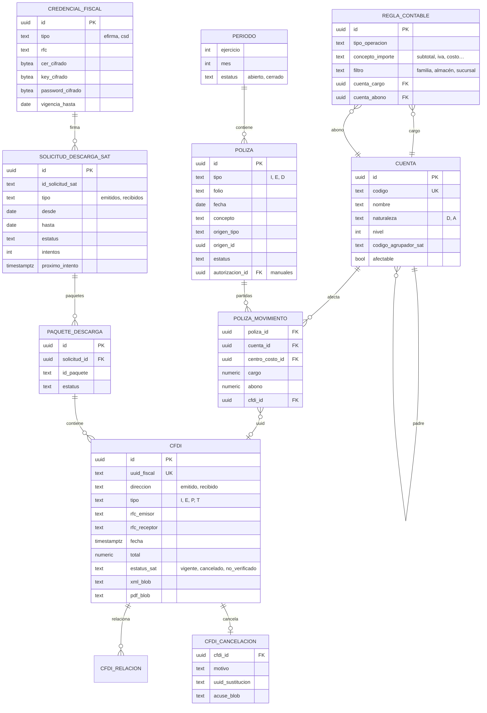

### 4.9 Cargas por layout, bitácora y procesos

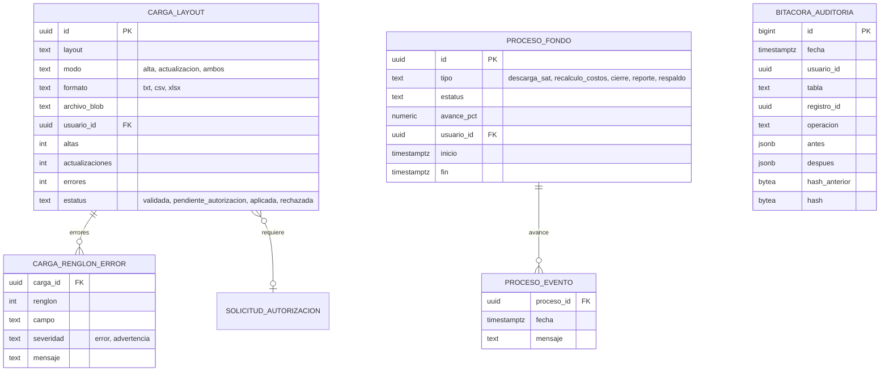

---

## 5. Plan de fases detallado

> ✅ **Aprobado (21/11/2026).**

Propongo dividir la Fase 1 en dos entregas (1A y 1B) porque es la más grande y todo depende de ella. Cada fase termina con: demostración, instrucciones de prueba, pruebas automáticas en verde, commits en español y **tu visto bueno**.

| Fase | Entregables concretos | Criterio de aceptación (tuyo) |
|---|---|---|
| **0** | Este documento + preguntas pendientes | Aprobación por escrito |
| **1A. Base y seguridad** | Repositorio con ramas `desarrollo` y `main`, pruebas automáticas en cada push, proyecto de Netlify conectado, despliegue de prueba vacío para verificar migraciones, previews y respaldo al publicar, migraciones base, envoltorio de permisos y transacción, bitácora con cadena de hashes, autenticación con TOTP, PIN de cajero, usuarios, roles, matriz módulo × acción, alcance por sucursal/almacén, datos sensibles, límites por monto, incompatibilidades, bitácora de accesos, reporte "quién puede hacer qué" a Excel, `configuracion`, indicador de consumo, README | Cada puesto de prueba solo ve y hace lo de la matriz (probado también llamando directo a la API); las combinaciones incompatibles se bloquean; nadie puede editar la bitácora |
| **1B. Catálogos y layouts** | Catálogos de 4.1, motor genérico de layouts (TXT pipe/tab, CSV, XLSX, UTF‑8/Win‑1252, DD/MM/AAAA, `1,250.75`), plantilla descargable con hoja de instrucciones y listas desplegables, simulación, reporte de errores en el mismo layout, aplicación en una transacción, exportación en el mismo layout, bitácora de cargas, autorización de cargas sensibles. Datos ficticios marcados `PRUEBA-` | Cargas tus 70 SKU, materias primas, masas y recetas en TXT y en Excel; se detectan los errores que metas a propósito; nada se guarda a medias |
| **2. Recetas y explosión** | Recetas N1/N2 con versiones y % panadero, detección de ciclos, explosión N2→N1→N0, lotes según regla, requerimiento neto, aviso de piezas que alcanzan, requisición automática (en borrador hasta la Fase 4), costo estándar en cadena e impacto en margen | Kg de masa, lotes y requerimiento neto cuadran con tu Excel |
| **3. Inventarios** | Movimientos, kárdex valuado (promedio/PEPS), lotes y caducidades, traspasos, conteos cíclicos con ajuste autorizado, alertas de mínimo/reorden | El kárdex cuadra con tu ejercicio |
| **4. Compras** | Motor de autorizaciones por niveles, requisición → OC (PDF/correo) → recepción → XML del proveedor → cotejo a 3 vías → CxP, pagos, antigüedad de saldos, comparativo de precios | Ninguna OC sin autorización; el cotejo detecta diferencias |
| **5. Producción y costos** | Vales de surtido, órdenes N1/N2 enlazadas, PEP con inventario de masas, avance por etapa, cierres, sobrantes, mermas, balance de masa y piezas, trazabilidad por lote, variaciones, estado de costo de producción y ventas, conciliación con contabilidad | Un día simulado cuadra masa y piezas; el estado de costos cuadra con MP, PEP, PT y contabilidad |
| **6. POS** | POS táctil PWA, pedidos con anticipo (toma, abonos, entrega, cancelación autorizada), PIN y cambio de cajero, apertura, retiros, cortes X/Z, arqueo, devoluciones autorizadas, ticket con capa de impresión, modo sin conexión (si aplica), adaptador definitivo de impresora | Un día de ventas simulado cuadra caja, inventario y ventas |
| **7. Contabilidad** | Catálogo con código agrupador, reglas de contabilización, pólizas automáticas desde las fases 3–6 (ya se generan desde que existe cada módulo, contra reglas configurables), pólizas manuales, balanza, auxiliares, diario, estados financieros, cierre de periodo | La balanza cuadra y cada póliza tiene su documento origen |
| **8. SAT y PAC** | Carga cifrada de e.firma/CSD, timbrado, cancelación, complemento de pago, factura nominativa y global, descarga masiva 1.5 en segundo plano, verificación de estatus, conciliaciones, Anexo 24, papeles de trabajo de IVA/IEPS/DIOT, archivo externo de XML | Timbrado exitoso en sandbox; descarga y conciliación de un mes real |
| **9. Salida a producción** | Tablero y reportes de 4.10, manual de usuario, respaldo externo con Object Lock, **prueba de restauración**, revisión de permisos y secretos, operación en paralelo | Uso en paralelo el periodo que definas |

> ✅ **Decisión (21/11/2026): se ADELANTA el POS.** Orden de construcción: **1A → 1B → 2 → 3 → 6 (POS) → 4 → 5 → 7 → 8 → 9**.

**Reemplazo de Soft Restaurant:** el negocio quiere dar de baja Soft Restaurant. Opción a decidir: mantener el orden (Soft Restaurant opera hasta la Fase 6) o **adelantar el POS justo después de la Fase 3** (orden 1A → 1B → 2 → 3 → 6 → 4 → 5 → 7 → 8 → 9), para retirarlo antes. Al adelantarlo, las pólizas del POS se generan desde el inicio y quedan "pendientes de configuración" mientras no estén las reglas contables. La migración de datos de Soft Restaurant (catálogo, precios, clientes e historial de ventas) se hace con los layouts de la Fase 1B.

Nota sobre el orden: el documento pone Contabilidad en la Fase 7, pero las fases 3 a 6 ya generan pólizas. Propongo crear en la **Fase 1B** el catálogo de cuentas y la tabla de reglas de contabilización (solo estructura y layout), para que cada movimiento genere su póliza desde que existe. Si una regla no está capturada, la póliza queda "pendiente de configuración" en lugar de suponer cuentas. La Fase 7 agrega reportes, pólizas manuales y cierre.

---

## 6. Qué necesito para empezar la Fase 1A

1. Tu **aprobación** de este documento (o los cambios que quieras).
2. ~~Acceso de Claude al repositorio~~ ✅ listo.
3. Las respuestas marcadas **[Bloquea F1]** en `01-preguntas-pendientes.md`: P03 (plan Pro por créditos en tu cuenta de Netlify), P08, P09, P11 (sucursales, planta y almacenes), P16 (matriz de puestos) y P20 (autenticación).
