# PROMPT PARA CLAUDE CODE — Sistema integral de control para panadería (ERP)

> **Versión 3 (21/11/2026):** el desarrollo se hace en un **repositorio temporal de GitHub** y en un **proyecto temporal en la cuenta actual de Netlify**, ambos del dueño, solo con datos ficticios. Antes de cargar datos reales se traslada a la estructura definitiva del negocio.

> **Antes de pegar este prompt:** llena la sección 2 ("Datos del negocio"). Lo que dejes como `[POR DEFINIR]`, Claude Code te lo va a preguntar en la Fase 0 antes de programar.

---

## 1. Rol y forma de trabajo

Actúa como arquitecto de software y desarrollador full‑stack con experiencia en sistemas ERP para manufactura de alimentos en México, contabilidad conforme a NIF y requisitos fiscales del SAT (CFDI 4.0, contabilidad electrónica).

Vas a construir, por fases, un sistema web para controlar una panadería: punto de venta, recetas, producción y costos, inventarios y almacenes, compras con autorizaciones, contabilidad y conexión fiscal con el SAT.

Reglas de trabajo (obligatorias):

1. **No inventes datos ni supuestos.** Si falta un dato (tasas, montos de autorización, rendimientos de receta, cuentas contables, método de valuación, etc.), **pregúntame antes** de asignar un valor. Ningún valor de negocio va "en duro" en el código: todo va en catálogos o en configuración editable.
2. **Trabaja por fases** (sección 5). Al terminar cada fase: muéstrame qué hiciste, cómo probarlo, y espera mi visto bueno antes de seguir.
3. **Antes de escribir código en la Fase 0**, entrégame: preguntas pendientes, propuesta de arquitectura, modelo de datos (diagrama entidad‑relación en Mermaid) y plan de fases con entregables. No programes hasta que lo apruebe.
4. Usa aritmética **decimal exacta** (nunca punto flotante) para cantidades, costos, precios e impuestos. Moneda: MXN. Cantidades de materia prima con al menos 4 decimales; importes a 2 decimales con redondeo definido en configuración.
5. Toda operación que afecte inventario, costos, caja o contabilidad debe dejar **bitácora de auditoría** (usuario, fecha/hora, valor anterior, valor nuevo) y no se borra: se cancela con movimiento contrario.
6. Haz commits al terminar cada parte funcional, con mensajes claros en español, y súbelos (push) al repositorio temporal de GitHub. Trabaja en la rama `desarrollo`. Solo pasa cambios a `main` con mi aprobación.
7. Escribe pruebas automáticas para los cálculos críticos: explosión de recetas, costeo, valuación de inventarios, impuestos y pólizas contables.
8. Los datos de prueba deben estar **marcados claramente como ficticios** y separados de los datos reales.
9. Interfaz y documentación en **español de México**.

---

## 2. Datos del negocio (llenar)

| Concepto | Valor |
|---|---|
| Nombre comercial | [POR DEFINIR] |
| Razón social y RFC | [POR DEFINIR] |
| Régimen fiscal | [POR DEFINIR] |
| Número de sucursales / puntos de venta | [POR DEFINIR] |
| Número de cajas por sucursal | [POR DEFINIR] |
| Almacenes (ej. materia prima, producción, producto terminado, por sucursal) | [POR DEFINIR] |
| Número de productos terminados (SKU) | 70 |
| ¿Se venden productos por pieza, por peso o ambos? | [POR DEFINIR] |
| ¿Hay venta a mayoreo / clientes con crédito? | [POR DEFINIR] |
| Método de valuación de inventarios (costo promedio, PEPS) | [POR DEFINIR] |
| Base de prorrateo de gastos indirectos de fabricación | [POR DEFINIR] |
| Niveles y montos de autorización de compras | [POR DEFINIR] |
| Proveedor de timbrado (PAC) | [POR DEFINIR] |
| Puestos que usarán el sistema y qué puede hacer cada uno (ver sección 4.0) | [POR DEFINIR — te entrego la matriz de puestos y permisos] |
| Masas base que se preparan (ej. masa de bolillo, masa de concha, hojaldre, galleta…) | [POR DEFINIR] |
| Otros intermedios (cubiertas, rellenos, betunes, almíbares) | [POR DEFINIR] |
| Etapas del proceso en el área de producción (ej. amasado, reposo/fermentación, formado, horneado, decorado/empaque) | [POR DEFINIR] |
| ¿Las masas se preparan en lotes completos (capacidad de la amasadora) o en la cantidad exacta? | [POR DEFINIR] |
| Vida útil de cada masa e intermedio (horas/días) y si el sobrante se puede reutilizar | [POR DEFINIR] |
| ¿El POS debe funcionar sin internet? | [POR DEFINIR] |
| Equipo de cada caja (computadora Windows/Mac, tableta Android, iPad) | [POR DEFINIR] |
| Impresora de tickets | **Ya se tiene.** Marca/modelo, ancho de papel y conexión: [POR DEFINIR — te los paso después] |
| ¿Cajón de dinero conectado a la impresora? ¿Lector de código de barras? ¿Báscula? | [POR DEFINIR] |
| Horario de operación del negocio (para estimar el consumo de la base de datos) | [POR DEFINIR] |
| Dónde guardar la copia de respaldos fuera de Netlify | [POR DEFINIR] |
| Repositorio de GitHub (temporal, para desarrollo) | `carsam68-MonheyB/SAS-EL-PAN-DE-CADA-DIA` (privado) |
| Netlify para desarrollo (temporal) | Proyecto nuevo en mi cuenta actual de Netlify (plan Pro por créditos) |
| Estructura definitiva de producción (cuenta de GitHub/Netlify del negocio) | [POR DEFINIR — se decide antes de cargar datos reales] |
| Hosting / base de datos | Netlify + Netlify Database (ver sección 3) |

---

## 3. Arquitectura y plataforma (definida)

El sistema es de **uso interno**: solo lo usan los empleados del negocio, pero debe estar en línea para entrar desde cualquier sucursal o dispositivo. Plataforma elegida:

| Pieza | Qué se usa |
|---|---|
| Código | **Repositorio privado temporal en mi cuenta de GitHub** (`carsam68-MonheyB/SAS-EL-PAN-DE-CADA-DIA`). Claude Code trabaja en una sesión en la nube conectada a ese repositorio; no se instala nada en mi computadora |
| Hosting y despliegue | **Proyecto nuevo en mi cuenta actual de Netlify**, conectado al repositorio de GitHub: despliegue automático de `main` y *deploy previews* de las ramas. Es temporal: solo para desarrollo y pruebas |
| Estructura definitiva | Antes de cargar datos reales, el código y el despliegue se trasladan a la cuenta del negocio que yo defina (GitHub y Netlify), con llaves nuevas |
| Backend | **Netlify Functions** (TypeScript) |
| Base de datos | **Netlify Database** (PostgreSQL administrado). Usa el paquete actual `@netlify/database` y migraciones versionadas en el repositorio; no uses el paquete anterior `@netlify/neon` |
| Archivos (XML y PDF de CFDI, respaldos exportados) | Almacenamiento de archivos a proponer en Fase 0 (ej. Netlify Blobs) más una copia fuera de Netlify |
| Procesos largos o programados | **Background Functions** y **Scheduled Functions** de Netlify |
| Frontend | Aplicación web responsiva (framework a proponer en Fase 0), instalable como PWA en tabletas del POS y de producción |

Antes de programar, revisa la documentación vigente de Netlify (límites de funciones, Netlify Database, autenticación y consumo del plan) y avísame si algo de este documento no cabe en la plataforma o en mi plan.

Restricciones técnicas que debes respetar:

1. **Nada es público.** Todas las páginas y todas las funciones exigen sesión iniciada; no hay registro abierto: solo el administrador da de alta usuarios. Los permisos de la sección 4.0 se validan **en cada función del servidor**, no solo ocultando botones.
2. **Autenticación:** propónme en Fase 0 la opción (Netlify Identity, Auth0 u otra) que cumpla con el doble factor que pide la sección 4.0. Los roles y permisos finos viven en la base de datos del sistema, no en el proveedor de autenticación.
3. **Transacciones:** toda operación que mueva inventario, caja o contabilidad se ejecuta en **una sola transacción de base de datos** (con un cliente del pool, `BEGIN`/`COMMIT`), para que nunca quede un movimiento a medias.
4. **Tiempo de ejecución:** las funciones normales tienen límite de pocos segundos. Descarga masiva del SAT, conciliaciones, recálculo de costos, cierres y reportes pesados van en Background Functions o Scheduled Functions, con registro de avance y estatus visible en pantalla.
5. **Secretos:** la llave de cifrado, las credenciales del PAC y las de la base de datos van en variables de entorno de Netlify. La e.firma (.cer y .key) y su contraseña se guardan **cifradas en la base de datos** con esa llave (no en el repositorio, no en logs). Solo el rol autorizado puede cargarlas o usarlas.
6. **Ambientes durante el desarrollo (temporales):**
   - **Rama `desarrollo` y deploy previews:** aquí se prueba cada cambio. Cada deploy preview recibe su propia rama de base de datos.
   - **Rama `main`:** se despliega sola en el proyecto temporal de mi cuenta. Solo se pasa a `main` con mi aprobación.
   - En mi cuenta de Netlify y en el repositorio temporal **solo hay datos ficticios**: nada de ventas o clientes reales, ni la e.firma o el CSD reales. El PAC se usa en su ambiente de pruebas.
   - Las variables de entorno del ERP se definen **a nivel del proyecto**, nunca a nivel del team, porque en mi cuenta hay otros proyectos.
   - **Traslado a la estructura definitiva:** antes de cargar datos reales, documenta y ejecuta el procedimiento: repositorio y proyecto en la cuenta del negocio, llaves nuevas, base nueva construida con las migraciones, desactivar las deploy previews en producción, carga de datos reales por layout.
7. **Respaldos y conservación:** Netlify respalda la base a diario y conserva esos respaldos por un plazo limitado según el plan. Además:
   - Exportación automática de la base (al menos mensual, y al cierre de cada mes contable) a un almacenamiento **fuera de Netlify** que yo indique, conservada como mínimo el plazo legal de conservación de la contabilidad.
   - Los XML de CFDI emitidos y recibidos se archivan por separado, organizados por RFC, año y mes.
   - Procedimiento documentado de restauración y una prueba de restauración antes de salir a producción.
   - Ninguna función debe tener permiso de borrar respaldos.
8. **Impresión de tickets:** el negocio **ya tiene impresora**; te daré el modelo. La app está en la nube y la impresora en la caja, así que la impresión se resuelve en el equipo de la caja. Cuando tengas el modelo, revisa su compatibilidad y compárame estas opciones con su costo (incluidas licencias) para recomendar una. Diseña el módulo de impresión aparte (una capa de impresión intercambiable) para que el resto del POS se pueda construir antes de conocer el modelo:
   - **Diálogo de impresión del navegador:** lo más sencillo, pero el cajero confirma cada ticket y el formato depende de los márgenes del navegador.
   - **Agente de impresión local** instalado en la computadora de la caja (ej. QZ Tray): impresión silenciosa en ESC/POS, apertura del cajón de dinero y estado de la impresora.
   - **Impresora de red con SDK del fabricante** (ej. Epson ePOS): imprime desde el navegador por la red local, útil si la caja es tableta.
   El ticket se diseña para papel de 58 u 80 mm (según la impresora), con folio, código QR o datos para facturar, y opción de reimpresión con permiso. Si confirmo el modo sin conexión: cola local de ventas que se sincroniza al volver el internet.
9. **Respaldo del código:** el código vive en GitHub. Además, en cada versión aprobada genera un paquete descargable (sin `node_modules`, sin `.env` ni secretos) para que yo guarde una copia fuera de GitHub.
10. **Consumo de la base de datos:** Netlify cobra la base por horas activas. Configura el auto‑escalado al mínimo necesario y la suspensión por inactividad; agrega en la pantalla de administración un indicador de consumo de créditos del mes.
11. Mantén un archivo `README.md` con instrucciones de instalación, variables de entorno necesarias (sin valores), cómo se despliega y el procedimiento de traslado a la estructura definitiva.

## 4. Módulos y requisitos funcionales

### 4.0 Administración de usuarios, roles y permisos
Es un módulo de primer nivel: se construye en la Fase 1 y **todos los demás módulos dependen de él**.

**Usuarios**
- Alta, edición, suspensión y baja (la baja desactiva, no borra, para conservar la historia de sus movimientos).
- Cada usuario tiene: nombre, puesto, correo, sucursal(es) y almacén(es) donde puede operar, uno o varios roles, fecha de alta y de baja.
- Contraseñas con política mínima, cambio obligatorio en el primer acceso, bloqueo tras varios intentos fallidos y cierre de sesión por inactividad (valores configurables).
- Doble factor de autenticación obligatorio para los roles que yo indique (como mínimo: administrador, autorizadores y quien maneje la e.firma o el PAC).
- PIN rápido para cajeros en el POS, con cambio de cajero sin cerrar la caja.

**Roles por puesto**
- Un rol = un puesto. Los roles son **plantillas editables**: me propones una matriz inicial a partir de los puestos que te dé en la sección 2 y yo la ajusto antes de programarla.
- Puestos de referencia para la propuesta (los confirmo yo): administrador del sistema, dirección, contralor, contador/auxiliar contable, compras, autorizador de compras (por nivel), almacenista de materia prima, jefe de producción, maestro de masas / panadero, encargado de sucursal, cajero.

**Permisos**
- Matriz **módulo × acción**: ver, crear, editar, cancelar, autorizar, cerrar (periodo, caja, orden), exportar e imprimir.
- **Alcance:** por sucursal y por almacén (un encargado ve y opera solo su sucursal; un almacenista, solo su almacén).
- **Permisos sobre datos sensibles**, separados de los permisos del módulo:
  - *Ver costos y márgenes* (ej. el cajero y el panadero no ven costos).
  - *Ver la receta completa* (fórmula y cantidades) vs. *ver solo la orden de producción* con lo que hay que preparar.
  - *Modificar precios de venta*.
  - *Usar e.firma / timbrar / cancelar CFDI*.
- **Límites por monto** para autorizar compras, ajustes de inventario, descuentos y devoluciones.

**Segregación de funciones (controles)**
- El sistema impide, y avisa al asignar roles, combinaciones incompatibles, por ejemplo: quien solicita una compra no la autoriza; quien recibe mercancía no autoriza el pago; quien hace el conteo físico no autoriza el ajuste; el cajero no autoriza sus propias devoluciones ni su corte. La lista de incompatibilidades es configurable.
- Ningún usuario, incluido el administrador, puede borrar ni editar la bitácora.

**Bitácora y reportes**
- Bitácora de accesos (entradas, intentos fallidos, desde dónde) y de cambios de usuarios, roles y permisos (quién, cuándo, antes/después).
- Reporte "quién puede hacer qué" por usuario y por permiso, exportable a Excel, para revisión periódica (auditoría).

### 4.1 Catálogos maestros
- **Productos terminados (SKU):** clave SKU, código de barras, nombre, familia (ej. pan blanco, pan dulce, pastelería, galletas — las familias las defino yo), unidad de venta, precio de venta, imagen, receta asociada, activo/inactivo.
  - Datos fiscales por SKU: clave de producto/servicio SAT, clave de unidad SAT, objeto de impuesto, tasa de IVA e indicador/tasa de IEPS. **Estos campos los capturo yo con mi contador; no asignes tasas por default.**
- **Materias primas e insumos:** clave, nombre, unidad de compra, unidad de almacén, unidad de receta y **factores de conversión** (ej. bulto de harina en kg → gramos), costo, proveedor preferente, stock mínimo/máximo, punto de reorden, ¿maneja lote y caducidad?
- Empaques y material de envoltura como insumos (también entran en receta y costo).
- Proveedores (RFC, régimen, condiciones de pago, días de crédito), clientes (datos fiscales para factura), almacenes, centros de costo, sucursales, cajas, usuarios.
- **Toda la configuración y los catálogos se pueden cargar por layout** (TXT, CSV o Excel). Ver sección 4.11.

### 4.2 Recetas en tres niveles (lista de materiales)

La estructura de producto es **obligatoriamente multinivel**. La masa es el elemento central del negocio y se maneja como un producto intermedio con inventario y costo propios, no como un simple renglón de la receta del pan.

| Nivel | Qué es | Unidad | Ejemplos |
|---|---|---|---|
| **N0 – Materia prima e insumos** | Lo que se compra | La de compra, convertida a la de receta | Harina, azúcar, mantequilla, huevo, levadura, sal, rellenos comprados, empaques |
| **N1 – Intermedios** | Lo que se prepara en el área de producción y se usa en varios panes | kg / g | Masas base, cubiertas, rellenos, betunes, almíbares |
| **N2 – Producto terminado (SKU)** | Lo que se vende | Pieza (o kg si se vende a granel) | Los 70 SKU |

**Receta de intermedio (N1, ej. una masa):**
- Fórmula por lote: ingredientes N0 y cantidades. Capturable también en **porcentaje panadero** (harina = 100% y cada ingrediente como % de la harina), y el sistema convierte a kg.
- Rendimiento teórico del lote en kg de masa, tamaño de lote estándar/capacidad de la amasadora, merma de proceso (%), vida útil y condiciones (ambiente, refrigerada, congelada).
- Un intermedio puede usar otro intermedio (ej. masa madre o prefermento dentro de una masa).

**Receta de SKU (N2):**
- Masa que usa y **gramos de masa cruda por pieza** (peso de formado).
- Complementos N1 por pieza (ej. gramos de cubierta o de relleno).
- Insumos N0 directos por pieza (ej. ajonjolí, azúcar glass, empaque, etiqueta).
- Merma de formado (recortes) y merma de horneado (piezas dañadas), en % configurable.
- Mano de obra por etapa (minutos por lote o por pieza) para el costeo.

**Versiones:** cada receta (N1 y N2) tiene versión y vigencia; el costo histórico se conserva con la versión vigente en su momento.

**Costo estándar:** se calcula de abajo hacia arriba: costo N0 → costo por kg de cada masa/intermedio N1 → costo por pieza de cada SKU N2 (materia prima + mano de obra + gastos indirectos con la base de prorrateo que yo defina). Al cambiar el costo de un insumo se recalcula toda la cadena y se muestra el impacto en el margen de cada SKU.

### 4.3 Flujo de inventarios y producción

Hay dos flujos que se reflejan uno al otro: la **planeación** va de arriba hacia abajo (del SKU a la materia prima, "desincorporando" la receta) y la **ejecución física** va de abajo hacia arriba (de la materia prima al SKU).

```mermaid
flowchart LR
  subgraph PLAN["PLANEACIÓN (explosión de recetas)"]
    direction TB
    P1["1. Plan de producción<br/>piezas por SKU"] --> P2["2. Explosión N2 → N1<br/>kg de cada masa e intermedio"]
    P2 --> P3["3. Lotes de masa<br/>(redondeo a capacidad)"]
    P3 --> P4["4. Explosión N1 → N0<br/>kg de cada materia prima"]
    P4 --> P5["5. Requerimiento neto<br/>vs. existencias y pedidos"]
    P5 --> P6["6. Requisición de compra<br/>(módulo de compras)"]
  end
  subgraph EJEC["EJECUCIÓN (movimientos de inventario)"]
    direction TB
    A["Almacén MP"] -->|"Vale de surtido"| B["PEP · Etapa 1<br/>Preparación de masas"]
    B -->|"Cierre orden de masa<br/>kg reales"| C["PEP · Inventario de masas<br/>e intermedios"]
    C -->|"Consumo en orden de SKU"| D["PEP · Etapas 2..n<br/>Formado, horneado, decorado"]
    D -->|"Cierre orden SKU<br/>piezas buenas"| E["Almacén PT"]
    E -->|"Traspaso"| F["Sucursal"]
    F -->|"Venta"| G["Costo de ventas"]
    D -->|"Piezas dañadas"| M["Merma"]
    C -->|"Masa caducada"| M
    F -->|"No vendido"| M
  end
  P6 -.-> A
  P5 -.->|"Libera orden de producción"| B
```

#### A. Planeación (de arriba hacia abajo)

1. **Plan de producción** por día y turno (y por sucursal si aplica): piezas de cada SKU. Se captura manualmente o se sugiere a partir de ventas históricas menos existencias de producto terminado; el criterio de sugerencia lo defino yo.
2. **Explosión N2 → N1:** piezas × gramos de masa por pieza, ajustado por la merma de formado y de horneado → **kg de cada masa**. Las masas que comparten varios SKU se **agrupan** (ej. una misma masa para varias variedades). Igual para cubiertas, rellenos y demás intermedios.
3. **Lotes de masa:** kg requeridos menos masa en existencia vigente → kg a preparar → número de lotes según la regla que yo defina (lote completo o cantidad exacta). Si se redondea, el excedente planeado se muestra como sobrante esperado.
4. **Explosión N1 → N0:** lotes × fórmula de cada masa e intermedio + insumos N0 directos de los SKU → **requerimiento bruto de cada materia prima**.
5. **Requerimiento neto:** bruto − existencia disponible en el almacén de MP (descontando lo ya comprometido en otras órdenes) − pedidos en tránsito con llegada antes de la fecha de producción.
6. Si el neto es positivo → **requisición de compra** automática (entra al flujo de autorizaciones de la sección 4.6). Si no hay suficiente materia prima, el sistema avisa qué SKU no se podrán producir completos y cuántas piezas sí alcanzan.
7. Al aprobar el plan se generan las **órdenes de producción** enlazadas: primero las **órdenes de masa/intermedio (N1)** y después las **órdenes de SKU (N2)** que dependen de ellas. Una orden de SKU no puede iniciar si su masa no está disponible.

#### B. Ejecución (de abajo hacia arriba)

1. **Surtido de materia prima:** el almacenista entrega la materia prima con un **vale de surtido** por orden de masa. Movimiento: sale del almacén de MP y entra a **Producción en Proceso (PEP)**, etapa de preparación de masas. Si se entrega más o menos del estándar, se registra la diferencia con motivo.
2. **Preparación de masas (orden N1):** el maestro de masas cierra la orden capturando los **kg reales obtenidos**. El sistema calcula el rendimiento real vs. teórico. La masa queda como **inventario de intermedio dentro de PEP**, con lote, hora de elaboración, caducidad y costo (materia prima consumida + mano de obra + gastos indirectos de la etapa).
3. **Formado y horneado (orden N2):** se consume la masa (kg) y los complementos; se registran las piezas formadas. Las etapas internas de PEP (formado, fermentación, horneado, decorado, empaque) son las que yo configure; cada una puede registrar avance y merma.
4. **Cierre de la orden de SKU:** piezas buenas y piezas de merma (con causa). Las piezas buenas salen de PEP y entran al **almacén de producto terminado (PT)** al costo real de la orden.
5. **Masa sobrante:** si la masa es reutilizable dentro de su vida útil, regresa al inventario de intermedios; si no, se da de baja como merma con autorización.
6. **Distribución y venta:** traspaso de PT a sucursales; cada venta en el POS descarga PT de la sucursal y genera el costo de ventas.
7. **No vendido:** el producto que no se vende se registra con su destino (merma, donación, reproceso, venta de segunda); el tratamiento contable de cada destino lo defino yo.

#### C. Controles y cuadres obligatorios
- **Balance de masa por orden y por día:** kg de masa producidos = kg consumidos en SKU + sobrante a inventario + merma. Las diferencias fuera de tolerancia requieren explicación.
- **Balance de piezas:** piezas planeadas vs. formadas vs. buenas vs. merma.
- No se puede consumir masa caducada ni más masa de la existente sin autorización.
- **Trazabilidad por lote:** lote de materia prima → lote de masa → lote de SKU (útil para reclamos de calidad y caducidades).
- Cada paso genera automáticamente su movimiento de inventario y su póliza contable con las reglas de contabilización configuradas (sección 4.8).
- **Variaciones** por orden, por SKU, por masa y por periodo: de cantidad (rendimiento, merma) y de precio (costo real de insumos vs. estándar).

### 4.4 Estados de costos de producción
- **Estado de costo de producción y ventas** por periodo (mensual, con opción por rango de fechas y por sucursal/planta):
  - Inventario inicial de materia prima + compras netas − inventario final de materia prima = **materia prima utilizada**
  - + mano de obra directa
  - + gastos indirectos de fabricación
  - = **costo de producción**
  - + inventario inicial de producción en proceso − inventario final de producción en proceso
  - = costo de producción terminada
  - + inventario inicial de producto terminado − inventario final de producto terminado
  - = **costo de lo vendido**
- El inventario de **producción en proceso** incluye: masas e intermedios en existencia y órdenes de SKU abiertas al cierre, valuados a su costo acumulado.
- Reporte de costo por **etapa** (preparación de masas vs. formado/horneado) y costo real por kg de cada masa.
- Costo unitario real por SKU, margen bruto por SKU y por familia, ranking de rentabilidad de los 70 productos.
- Las cifras deben cuadrar con los saldos contables de inventarios (MP, PEP, PT) y costo de ventas (reporte de conciliación).

### 4.5 Inventarios y almacenes
- Múltiples almacenes y sucursales; existencias por almacén en tiempo real. Como mínimo se distinguen tres estados del inventario: **materia prima**, **producción en proceso** (incluye el inventario de masas e intermedios) y **producto terminado**, siguiendo el flujo de la sección 4.3.
- Movimientos: entradas por compra, salidas a producción, entradas de producción, traspasos entre almacenes/sucursales, ventas, devoluciones, mermas, ajustes (los ajustes requieren autorización).
- **Kárdex** por artículo con valuación según el método que yo elija.
- Lotes y fechas de caducidad para insumos que lo requieran; alerta de próximos a caducar.
- **Inventarios físicos / conteos cíclicos:** hoja de conteo, captura, diferencias y ajuste autorizado.
- Alertas de stock mínimo y punto de reorden.
- Cada movimiento genera su póliza contable automáticamente (sección 4.8).

### 4.6 Compras con autorizaciones
Flujo:
1. **Requisición** (manual o generada desde la explosión de materiales).
2. **Autorización por niveles** según monto, categoría o proveedor (reglas configurables; los montos los defino yo). Registro de quién autorizó, cuándo y comentarios. Rechazo con motivo.
3. **Orden de compra** al proveedor (PDF y envío por correo).
4. **Recepción** en almacén contra la OC (parcial o total), con lote/caducidad.
5. **Factura del proveedor:** carga del XML (CFDI) y validación contra OC y recepción (**cotejo a tres vías**: cantidades, precios, impuestos). Diferencias fuera de tolerancia requieren autorización.
6. **Cuentas por pagar** con antigüedad de saldos y programación de pagos; al pagar, solicitar/registrar el complemento de pago del proveedor.
- Comparativo de precios históricos por insumo y proveedor.
- Ninguna OC se emite sin autorización vigente; nadie autoriza sus propias requisiciones.

### 4.7 Punto de venta (POS)
- Pantalla táctil con botones por familia y producto (con imagen), búsqueda por nombre y lector de código de barras.
- Venta por pieza y, si aplica, por peso (integración con báscula — preguntar modelo).
- Formas de pago: efectivo, tarjeta, transferencia, mixto (las que yo confirme).
- Ticket impreso (impresora térmica) con folio y datos para que el cliente pueda facturar.
- Apertura de caja con fondo, retiros parciales, **corte de caja (X y Z)**, arqueo por denominación y diferencias.
- Devoluciones y cancelaciones con autorización de supervisor.
- Descuento de inventario de producto terminado en tiempo real por sucursal.
- **Facturación:** factura nominativa a partir de un ticket y **factura global** de ventas al público en general con la periodicidad que yo defina.
- Modo sin conexión con sincronización posterior (si lo confirmo en la sección 2).

### 4.8 Contabilidad
- Catálogo de cuentas propio con **código agrupador del SAT**.
- **Pólizas automáticas** (ingreso, egreso, diario) generadas por cada operación: ventas, cortes de caja, compras, pagos, consumos de producción, entradas de PT, costo de ventas, mermas, ajustes de inventario. La tabla de **reglas de contabilización** (qué cuenta va al cargo y al abono por tipo de operación) debe ser configurable; la lleno yo.
- Cada póliza enlazada a su documento origen y, cuando exista, al **UUID del CFDI**.
- Pólizas manuales con autorización.
- Reportes: balanza de comprobación, auxiliares, libro diario, estado de resultados, balance general, flujo de efectivo.
- Cierre de periodo (bloquea movimientos del mes cerrado).

### 4.9 Fiscal y conexión con el SAT
- **Emisión de CFDI 4.0** (ingreso, egreso, pago con complemento de pagos) mediante **PAC** vía su API: timbrado, cancelación con motivo y folio de sustitución, envío por correo de XML y PDF. Usar ambiente de pruebas del PAC antes de producción.
- **Descarga masiva de CFDI** emitidos y recibidos mediante el **Web Service de Descarga Masiva del SAT** autenticando con e.firma (versión vigente del servicio; verifica la documentación actual del SAT antes de implementar). Manejo de solicitudes, verificación de estatus y reintentos con límites, porque el servicio puede tardar o estar intermitente.
- **Verificación del estatus** de los CFDI recibidos (vigente/cancelado) antes de contabilizarlos.
- **Conciliación** CFDI recibidos del SAT vs. compras registradas, y CFDI emitidos del SAT vs. ventas/facturas del sistema; reporte de diferencias.
- **Contabilidad electrónica** (Anexo 24): generar XML de catálogo de cuentas, balanza de comprobación y, cuando se requiera, pólizas y auxiliares.
- Papeles de trabajo de impuestos: IVA por tasa (incluyendo actividades a tasa 0% y 16% según la configuración de cada SKU), IEPS cobrado y acreditable, retenciones, y base para la **DIOT**. Los cálculos deben salir de la configuración fiscal que yo capture; si algo no está configurado, el sistema lo marca como pendiente, no lo supone.

### 4.10 Tablero y reportes de gestión
- Ventas por día, hora, sucursal, cajero, SKU y familia.
- Margen por SKU (precio vs. costo estándar y vs. costo real).
- Mermas por SKU y por causa.
- Rotación y días de inventario de materia prima y producto terminado.
- Compras por proveedor y variación de precios de insumos clave.
- Todo exportable a Excel.

### 4.11 Carga masiva por layout (TXT / CSV / Excel)
La captura inicial y los cambios masivos deben ser **muy sencillos**: descargo un layout, lo lleno y lo subo. Nada de capturar uno por uno los 70 SKU ni sus recetas.

**Qué se puede cargar por layout (como mínimo):**
| Layout | Contenido |
|---|---|
| Unidades y conversiones | Unidad de compra, de almacén y de receta, y sus factores |
| Materias primas e insumos | Clave, nombre, unidades, costo, proveedor preferente, mínimos/máximos, lote y caducidad |
| Masas e intermedios (N1) | Encabezado de la receta: clave, nombre, rendimiento por lote, tamaño de lote, merma, vida útil |
| Fórmula de masas e intermedios | **Un renglón por ingrediente**: clave del intermedio, versión, clave del componente, cantidad o % panadero, unidad, merma |
| Productos terminados (SKU, N2) | Clave SKU, código de barras, nombre, familia, unidad de venta, precio, datos fiscales SAT |
| Receta de SKU | **Un renglón por componente**: clave SKU, versión, tipo (masa, intermedio, insumo, empaque), clave, cantidad por pieza, unidad, merma |
| Etapas y mano de obra por receta | Etapa, minutos por lote o por pieza |
| Precios de venta | Clave SKU, precio, sucursal (si aplica), fecha de vigencia |
| Proveedores y clientes | Datos generales y fiscales |
| Almacenes, sucursales y cajas | Claves y descripciones |
| Existencias iniciales | Almacén, clave, cantidad, costo unitario, lote y caducidad |
| Usuarios | Nombre, correo, puesto/rol, sucursal y almacén (sin contraseñas: el sistema envía la invitación) |
| Catálogo de cuentas | Cuenta, nombre, naturaleza, nivel, código agrupador SAT |
| Reglas de contabilización | Tipo de operación, cuenta de cargo, cuenta de abono |
| Saldos iniciales contables | Cuenta, saldo deudor/acreedor a la fecha de arranque |
| Plan de producción | Fecha, turno, sucursal, clave SKU, piezas |

**Formatos aceptados:**
- **TXT delimitado** (por pipe `|` o por tabulador), **CSV** y **Excel (.xlsx)**. El delimitador se detecta o se elige al subir.
- Acepta acentos y ñ aunque el archivo venga de Excel en Windows (detectar codificación UTF‑8 o Windows‑1252).
- **Formato de México:** fechas en **DD/MM/AAAA** (ej. 21/11/2026) y números con **coma para miles y punto para decimales** (ej. 1,250.75). En pantallas, reportes y exportaciones se muestran siempre así; en los layouts se acepta con o sin la coma de miles (1,250.75 o 1250.75), pero el punto siempre es el decimal. Como la coma de miles choca con la coma separadora del CSV, los layouts TXT se descargan **separados por pipe `|`** por default, y en CSV los números con coma deben ir entre comillas (el sistema los genera así al exportar). Si una fecha no tiene ese formato o no existe (ej. 31/02/2026), se marca como error en la validación previa. Este formato va explicado en cada layout y es el mismo que usa la interfaz del sistema.

**Cada layout se descarga desde el sistema e incluye:**
- La fila de encabezados exacta.
- Una hoja o archivo de **instrucciones**: para cada campo, nombre, si es obligatorio, tipo de dato, longitud máxima, valores válidos (ej. lista de familias o de unidades existentes) y un ejemplo.
- En la versión Excel, listas desplegables para los campos que vienen de un catálogo.

**Flujo de carga:**
1. Elegir el layout y el modo: **alta**, **actualización** (por clave) o **alta y actualización**. El layout nunca borra: dar de baja se hace con un campo de estatus "inactivo".
2. Subir el archivo.
3. **Validación previa (simulación) sin guardar nada:** reporte por renglón con errores (campo vacío, clave inexistente, unidad no válida, cantidad negativa, receta que se llama a sí misma, componente duplicado) y advertencias (ej. el costo cambió más de cierto %). Muestra cuántos registros se darán de alta, cuántos se actualizarán y cuántos tienen error. El reporte de errores se descarga en el mismo layout con una columna de "error" para corregir y volver a subir.
4. **Confirmar:** se importa todo en **una sola transacción**; si algo falla no se guarda nada a medias.
5. **Bitácora de cargas:** quién subió, cuándo, archivo original guardado, modo, número de registros y resultado. Los cambios quedan en la bitácora de auditoría con valor anterior y nuevo.

**Exportar en el mismo layout:** cada catálogo se puede descargar con sus datos actuales en el mismo formato de carga, para editarlo en Excel y volverlo a subir (ej. actualizar todos los precios o costos de una vez).

**Permisos:** solo los roles con el permiso "importar" del catálogo correspondiente pueden cargar layouts. Las cargas que afectan inventario, precios o contabilidad (existencias iniciales, precios, saldos iniciales) requieren autorización antes de aplicarse.

---

## 5. Plan de fases

| Fase | Entregable | Criterio de aceptación |
|---|---|---|
| **0. Descubrimiento y diseño** | Preguntas pendientes, validación de la plataforma Netlify contra este documento (incluido el esquema temporal GitHub + Netlify y el traslado), opción de autenticación, modelo de datos (Mermaid), plan detallado | Yo lo apruebo por escrito |
| **1. Base, usuarios, catálogos y layouts** | Proyecto, módulo completo de usuarios, roles y permisos (4.0), catálogos y **carga masiva por layout (4.11)** con validación previa | Cada puesto de prueba solo ve y hace lo que dice la matriz aprobada (probado también contra la API); se bloquean las combinaciones incompatibles; cargo mis 70 SKU, materias primas, masas y recetas con los layouts en TXT y en Excel, el sistema detecta los errores que meta a propósito y no guarda nada a medias |
| **2. Recetas y explosión** | Recetas N1 (masas e intermedios) y N2 (SKU), porcentaje panadero, versiones, planeación completa (4.3‑A), costo estándar en cadena | Con un plan de producción, los kg de cada masa, los lotes y el requerimiento neto de MP cuadran con mi cálculo manual en Excel |
| **3. Inventarios y almacenes** | Movimientos, kárdex, valuación, traspasos, conteos | El kárdex valuado cuadra con un ejercicio que yo prepare |
| **4. Compras y autorizaciones** | Requisición → autorización → OC → recepción → XML proveedor → CxP | Una OC no se emite sin autorización; el cotejo a tres vías detecta diferencias |
| **5. Producción y costos** | Ejecución completa (4.3‑B): vales de surtido, órdenes de masa y de SKU enlazadas, inventario de masas en PEP, cierres, sobrantes, mermas, cuadres (4.3‑C), variaciones, estado de costo de producción y ventas | Un día simulado cuadra el balance de masa y de piezas; el estado de costos cuadra con MP, PEP, PT y contabilidad |
| **6. Punto de venta** | POS, cortes de caja, devoluciones, ticket | Un día de ventas simulado cuadra caja, inventario y ventas |
| **7. Contabilidad** | Catálogo, reglas de contabilización, pólizas automáticas, reportes, cierre | La balanza cuadra y cada póliza tiene su documento origen |
| **8. SAT y PAC** | Timbrado, cancelación, complemento de pago, factura global, descarga masiva, conciliación, contabilidad electrónica | Timbrado exitoso en ambiente de pruebas del PAC; descarga y conciliación de un mes real |
| **9. Tablero, pruebas finales y salida a producción** | Reportes, manual de usuario, prueba de restauración de respaldo, revisión de permisos y secretos | Uso en paralelo con el sistema actual durante el periodo que yo defina |

---

## 6. Al iniciar

La **Fase 0** ya está hecha en `docs/fase-0/` del repositorio. Léela, actualízala con esta versión del prompt y espera mi aprobación. Si se empieza de cero: lee este documento completo, hazme todas las preguntas de los puntos marcados `[POR DEFINIR]` y de cualquier otro dato que necesites, y preséntame la arquitectura y el modelo de datos. No escribas código hasta que yo apruebe.
